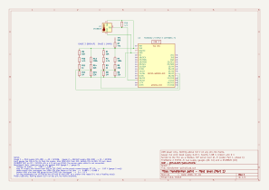

# Transformer ATS logic and IEC 104

This project is about a small version of the engineering of a transformer distribution system: a desk-size 10/0.4 kV transformer point with two supplies, built at 3.3 V.

In real life, we may have some electricity problems. We have a main supply and a backup supply. But sometimes the main supply can fail; at that time we have to switch to the backup supply, with some time delay, to prevent people from staying in the dark. However, this info can be untruthful, because our sensors may be dead and give us fake info about the main supply collapsing. For example, a gauge wire can be broken. So we are going to make a real-life simulation with my ESP32 at 3.3 V, resistors, Python and a PLC.

## The plan: three levels, four parts

| Level | What it is here |
|---|---|
| Field | ESP32 (FireBeetle 2 ESP32-E): two simulated supply gauges, a DS18B20 as the transformer temperature, two simulated breakers Q1/Q2. Serves everything as a Modbus TCP server over Wi-Fi. |
| Control | CODESYS SoftPLC on the laptop: ATS logic in ladder (undervoltage, on-delay timer, interlock, return to main, temperature alarm). |
| Supervisory | Python gateway acting as an RTU, serving IEC 60870-5-104 to a dispatcher client. |

1. **Field level**: I/O list, gauges, ESP32 sketch, Python test.
2. **ATS in ladder**: a short dip must not transfer, a long one must. CSV logs and plots.
3. **What-if tests**: stuck breaker, broken measurement wire, DS18B20 unplugged, Wi-Fi loss, PLC restart.
4. **IEC 104**: gateway and dispatcher client.

## Status

- **2026-11-04: Part 1 hardware done.** Both gauges built and measured, DS18B20 wired and checked, KiCad schematic drawn.
- **Next:** the ESP32 code (reading the gauges, the DS18B20, the breaker simulator, the Modbus TCP server), then the Python test. Then Parts 2 to 4.

## Safety rules

- USB power only.
- Nothing above 3.3 V on any pin.
- No mains anywhere in this project.

## Hardware

- DFRobot FireBeetle 2 ESP32-E (DFR0654)
- Resistors from a ±1 % kit, breadboard and jumper wires
- DS18B20 temperature sensor on a cable (the cable shield is not connected; on a 1 m desk cable it is not needed)
- Multimeter (UNI-T UT131A)
- KiCad 10.0.5 for the schematic



PDF: [hardware/transformer-point.pdf](hardware/transformer-point.pdf). KiCad project: [hardware/transformer-point/](hardware/transformer-point/).

| Pin | Connected to |
|---|---|
| A0 / GPIO36 | Gauge 1, main supply |
| A1 / GPIO39 | Gauge 2, backup supply |
| D2 / GPIO25 | DS18B20 data, with a 4.7k pull-up to 3.3 V |
| 3V3, GND | Breadboard + and − rails |

A0 and A1 are on ADC1. ADC2 shares hardware with Wi-Fi, so it is avoided. A2 (GPIO34) is not used, because on this board it is wired to the battery divider.

## How a gauge works

A gauge turns "how healthy is this supply?" into a voltage the ESP32 can read. It must also tell a **dead supply** apart from a **broken gauge wire**, so that the PLC never trusts a single reading blindly.

Each gauge has four parts:

- **Top resistor (10k + 4.7k + 1k = 15.7k)**: from the supply to the middle point.
- **Bias (100k + 22k = 122k)**: from the always-on 3.3 V to the middle point. It keeps a small voltage there even when the supply is dead: a "live zero", like the 4 mA in a 4–20 mA loop.
- **Bottom resistor (22k)**: from the middle point to GND.
- **1M pull-down**: at the ESP32 end of the long gauge wire. If the wire breaks, the pin is pulled to 0 V instead of floating.

Divider rule: V_out = V_in × bottom / (top + bottom). When two sources push from 3.3 V (supply and bias), their resistors combine in parallel: 1/R = 1/R1 + 1/R2.

The ESP32 ADC reads accurately between about 0.15 V and 2.45 V at its highest attenuation (ESP32 datasheet, Table 4-4), so every state is placed inside that range:

| State | How I make it on the breadboard | Meaning |
|---|---|---|
| Healthy | as built | about 2.0 V = 100 % |
| Sag | supply wire moved to the 47k (TP1 "SAG"), gauge 1 only | about 1.1 V = about 40 % |
| Dead | supply wire unplugged; only the bias is left | about 0.5 V = 0 % (live zero) |
| Broken wire | long wire from the gauge to the pin unplugged | 0 V = fault |

## Measurements (2026-11-04)

I predicted every value on paper before measuring it.

| What | Predicted | Measured |
|---|---|---|
| 3V3 rail | 2.2–2.8 V | 3.3 V |
| Gauge 1 (main), healthy | 2.00 V | 1.98 V |
| Gauge 1 (main), sag | 1.13 V | 1.10 V |
| Gauge 1 (main), dead | 0.495 V | 0.488 V |
| Gauge 1 (main), broken wire | 0 V | 0 V |
| Gauge 2 (backup), healthy | same as gauge 1 | 1.98 V |
| Gauge 2 (backup), dead | same as gauge 1 | 0.489 V |
| Gauge 2 (backup), broken wire | 0 V | 0 V |
| DS18B20 data line | "3.3 V / 4.7k" (wrong: that is a current, not a voltage) | jumping 1.2–3.3 V; steady 3.3 V with the D2 wire out |

The two gauges, built from ±1 % resistors, agree within 0.001 V.

## I/O map (planned, not built yet)

The ESP32 will serve these as Modbus TCP. Addresses start at 0.

| Table | Address | Tag | Meaning |
|---|---|---|---|
| Input register | 0 | U_MAIN | main gauge in mV (500 mV = 0 %, 2000 mV = 100 %; below about 250 mV = broken wire) |
| Input register | 1 | U_BACKUP | backup gauge in mV, same scale |
| Input register | 2 | T_XFMR | transformer temperature, signed, 0.1 °C |
| Input register | 3 | HEARTBEAT | counter, proves the ESP32 is alive |
| Discrete input | 0 | Q1_CLOSED | 1 = Q1 is ON |
| Discrete input | 1 | Q1_OPEN | 1 = Q1 is OFF |
| Discrete input | 2 | Q2_CLOSED | 1 = Q2 is ON |
| Discrete input | 3 | Q2_OPEN | 1 = Q2 is OFF |
| Discrete input | 4 | T_OK | temperature reading is valid |
| Discrete input | 5 | Q1_STUCK | test jumper on D3 (test only) |
| Discrete input | 6 | Q2_STUCK | test jumper on D12 (test only) |
| Coil | 0 | Q1_CLOSE_CMD | command: close Q1 |
| Coil | 1 | Q1_OPEN_CMD | command: open Q1 |
| Coil | 2 | Q2_CLOSE_CMD | command: close Q2 |
| Coil | 3 | Q2_OPEN_CMD | command: open Q2 |
| Holding register | 0 | Q1_CLOSE_MS | simulated closing time of Q1 |
| Holding register | 1 | Q2_CLOSE_MS | simulated closing time of Q2 |

Each breaker has two position contacts. Both 1 at the same time, or both 0 for too long, means a fault.

## What failed

1. **The first top resistor was wrong.** I built 14.3k, but that was the value of the top and the bias together, not the top alone. Taking away the bias with 1/R gave 16.19k; the closest from my kit was 10k + 4.7k + 1k = 15.7k.
2. **Swapped rails.** The FireBeetle's 3V3 and GND wires were in each other's rails. The pin read −0.7 V, and the meter on the rails showed −3.3 V. Fix: swapped them. Lesson: check the rails with the meter before every new layout.
3. **Wrong wire in the sag test.** I moved the 47k's feed wire instead of the supply wire, so sag and dead both read 1.98 V. Fix: I named the wires LEFT, RIGHT and LONG.
4. **Gauge 2: 1M with both legs in the same column.** It connected only to itself and did nothing. Fix: one leg moved to the − rail, and the two − rails bridged together.
5. **Gauge 2: resistor legs in the wrong holes**, giving 1.7 V and 1.6 V. Fix: rearranged them; then 1.98 / 0.489 / 0 V.
6. **The DS18B20 data line jumped between 1.2 and 3.3 V.** The Project 1 program was still on the board and kept talking to the sensor on D2; the meter is too slow to see each pulse, so it showed an average. Proof: with the D2 wire out, a steady 3.3 V.
7. **Schematic v1 had A0 and A1 wired to GND** (the wires started from the GND end of the 1M resistors), and the 47k went to GND. The electrical rules check (ERC) showed 0 errors, because it checks drawing rules, not what I meant: a wire from an input pin to GND is legal. Fix: redrawn to match the breadboard.

## What I learnt

What I learnt today is that building hardware is so interesting, and after building the hardware, making the schematic design is so easy: you just look at your hardware setup, then copy it to KiCad. (Mistake 7 shows the copy still needs checking.)

## How this was made

I built, measured and drew everything myself. Claude (an AI tutor) explained the ideas, checked my work, cleaned up the KiCad schematic (title block, notes, project symbol library, SAG test point) and turned my notes into this README.

## Repository layout

```
README.md
docs/transformer-point.svg          schematic picture for this page
hardware/transformer-point.pdf      schematic, PDF
hardware/transformer-point/         KiCad 10 project
```
