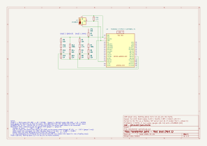
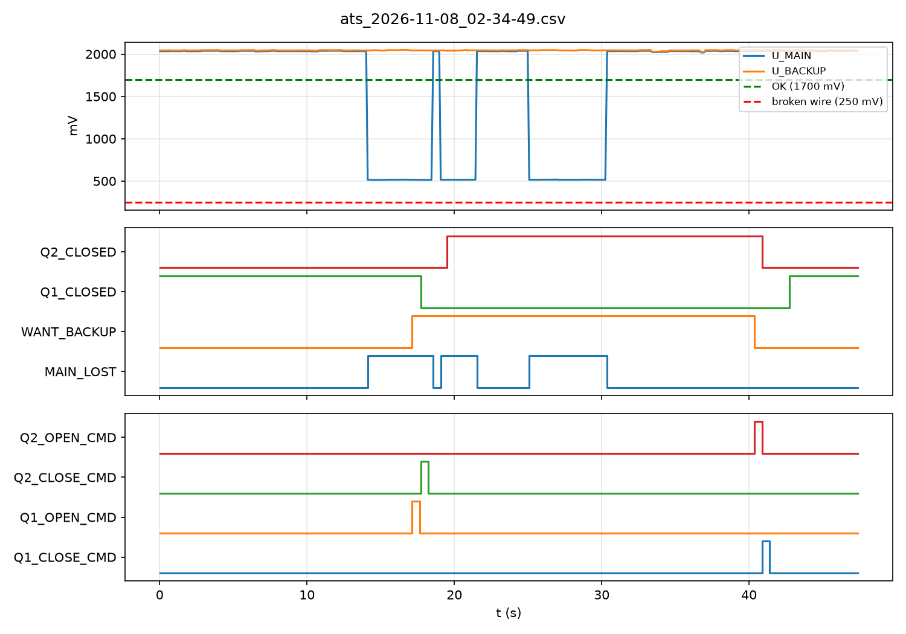

# Transformer point: the details

Everything behind the [README](../README.md): hardware, measurements, firmware, maps, the ladder, the IEC 104 gateway, and every failure.

## Safety rules

- USB power only.
- Nothing above 3.3 V on any pin.
- No mains anywhere in this project.

## Hardware

- DFRobot FireBeetle 2 ESP32-E (DFR0654)
- Resistors from a ±1 % kit, breadboard and jumper wires
- DS18B20 temperature sensor on a cable (the cable shield is not connected; on a 1 m desk cable it is not needed)
- Multimeter (UNI-T UT131A)
- KiCad 10.0.5 for the schematic



PDF: [hardware/transformer-point.pdf](../hardware/transformer-point.pdf). KiCad project: [hardware/transformer-point/](../hardware/transformer-point/).


Setup: 


| Pin | Connected to |
|---|---|
| A0 / GPIO36 | Gauge 1, main supply |
| A1 / GPIO39 | Gauge 2, backup supply |
| D2 / GPIO25 | DS18B20 data, with a 4.7k pull-up to 3.3 V |
| D3 / GPIO26 | Q1 "stuck" test jumper: loose end in the − rail = stuck (internal pull-up) |
| D12 / GPIO4 | Q2 "stuck" test jumper, same |
| D9 / GPIO2 | the board's LED = Q1 lamp (on = closed) |
| D8 / GPIO5 | the board's RGB LED = Q2 lamp (red = closed) |
| 3V3, GND | Breadboard + and − rails |

A0 and A1 are on ADC1. ADC2 shares hardware with Wi-Fi, so it is avoided for analog readings (D3 and D12 are only read as digital inputs). A2 (GPIO34) is not used, because on this board it is wired to the battery divider.

## How a gauge works

A gauge turns "how healthy is this supply?" into a voltage the ESP32 can read. It must also tell a **dead supply** apart from a **broken gauge wire**, so that the PLC never trusts a single reading blindly.

Each gauge has four parts:

- **Top resistor (10k + 4.7k + 1k = 15.7k)**: from the supply to the middle point.
- **Bias (100k + 22k = 122k)**: from the always-on 3.3 V to the middle point. It keeps a small voltage there even when the supply is dead: a "live zero", like the 4 mA in a 4–20 mA loop.
- **Bottom resistor (22k)**: from the middle point to GND.
- **1M pull-down**: at the ESP32 end of the long gauge wire. If the wire breaks, the pin is pulled to 0 V instead of floating.

Divider rule: V_out = V_in × bottom / (top + bottom). When two sources push from 3.3 V (supply and bias), their resistors combine in parallel: 1/R = 1/R1 + 1/R2.

The ESP32 ADC reads accurately between about 0.15 V and 2.45 V at its highest attenuation (ESP32 datasheet, Table 4-4), so every state is placed inside that range:

| State | How I make it on the breadboard | Meaning |
|---|---|---|
| Healthy | as built | about 2.0 V = 100 % |
| Sag | supply wire moved to the 47k (TP1 "SAG"), gauge 1 only | about 1.1 V = about 40 % |
| Dead | supply wire unplugged; only the bias is left | about 0.5 V = 0 % (live zero) |
| Broken wire | long wire from the gauge to the pin unplugged | 0 V = fault |

## Measurements

### With the multimeter (2026-11-04)

I predicted every value on paper before measuring it.

| What | Predicted | Measured |
|---|---|---|
| 3V3 rail | 2.2–2.8 V | 3.3 V |
| Gauge 1 (main), healthy | 2.00 V | 1.98 V |
| Gauge 1 (main), sag | 1.13 V | 1.10 V |
| Gauge 1 (main), dead | 0.495 V | 0.488 V |
| Gauge 1 (main), broken wire | 0 V | 0 V |
| Gauge 2 (backup), healthy | same as gauge 1 | 1.98 V |
| Gauge 2 (backup), dead | same as gauge 1 | 0.489 V |
| Gauge 2 (backup), broken wire | 0 V | 0 V |
| DS18B20 data line | "3.3 V / 4.7k" (wrong: that is a current, not a voltage) | jumping 1.2–3.3 V; steady 3.3 V with the D2 wire out |

The two gauges, built from ±1 % resistors, agree within 0.001 V.

### With the ESP32 (2026-11-05 to 2026-11-07)

| What | Multimeter | ESP32 |
|---|---|---|
| Gauge 1 (main), healthy | 1.98 V | 2039–2041 mV (16-sample average) |
| Gauge 2 (backup), healthy | 1.98 V | 2048–2050 mV (16-sample average) |
| Gauge 1 (main), dead | 0.488 V | 512–523 mV (single readings) |

- **ADC error.** The ESP32 reads about 30 mV high near 0.5 V and about 60 mV high near 2 V, roughly a 2 % gain error plus a 20 mV offset. Averaging 16 samples removes random noise, not this systematic error. The gauge states are at least 0.5 V apart, so an error of 30–60 mV cannot turn one state into another. I decided not to calibrate.
- **A short dip.** Unplugging and replugging the main supply wire showed 2030 → 517 → 2030 mV in the log. The ATS in Part 2 must not transfer on a dip like this, only on a long one. Once, both gauges dipped together, which points at the shared 3.3 V rail, not at one gauge.
- **Temperature.** Room: 20.1 °C. Held in my hand: 21.8 °C after 25 s. The sensor warms up slowly (thermal inertia), so a jump from 20 °C to 80 °C within a second would mean a fault, not real heat. That becomes a plausibility check in Part 3.
- **Heartbeat.** Read by Python about every 1.2 s, it mostly went up by 1 but sometimes by 2 (for example 19898 → 19900). The reader's loop (a 1 s sleep plus two reads over Wi-Fi) is longer than the ESP32's 1 s tick, and the two clocks are not in step. So the PLC's watchdog must check "did it change within a few seconds", never "did it go up by exactly 1".
- **Wi-Fi.** DHCP address 192.168.100.48, signal −60 dBm.
- **Interlock.** With Q2 closed, a close command for Q1 was refused: Q1's contacts did not change within 2 s, and the command coil was reset.

A real line from `tools/modbus_check.py`, with both breakers open:

```
U_MAIN=2043 mV | U_BACKUP=2050 mV | Temp=19.3 °C | Heartbeat=150 | T_OK=1 | Q1_CLOSED=0 | Q1_OPEN=1 | Q2_CLOSED=0 | Q2_OPEN=1 | Q1_STUCK=0 | Q2_STUCK=0
```

## Firmware

[firmware/field_node/field_node.ino](../firmware/field_node/field_node.ino). Nothing in it uses `delay()`: every job has its own `millis()` timer, so the Modbus server keeps answering all the time.

| How often | What it does |
|---|---|
| every loop | serves Modbus, reads the stuck jumpers, handles breaker commands, updates the position contacts and the Q1 lamp |
| every 100 ms | Q2's RGB lamp |
| every 500 ms | both gauges, 16-sample average in mV |
| every 1 s | DS18B20 temperature (non-blocking), T_OK, heartbeat +1 |
| every 5 s | Wi-Fi status on the serial monitor |

**Temperature quality flag.** If the DS18B20 is unplugged, register 2 keeps the last good value and T_OK goes to 0. So the PLC must check T_OK before it uses the temperature. It is the same idea as the quality bits in IEC 104.

**Breakers.** Each breaker is a small state machine:

```
            close command               closing time (HR) passed
  OPEN ──────────────────► CLOSING ─────────────────────────► CLOSED
   ▲                          │                                  │
   └────── open command ──────┴──────────────────────────────────┘
           (instant, wins from any state)

  contacts:  OPEN     CLOSED=0  OPEN=1
             CLOSING  CLOSED=0  OPEN=0   ← travelling
             CLOSED   CLOSED=1  OPEN=0
```

- **Commands are one-shot.** The ESP32 acts on a command coil and puts it back to 0. A coil left at 1 would close the breaker again after every open.
- **Two position contacts**, so the PLC can tell open, moving and fault apart. Both 0 for longer than the closing time means stuck halfway.
- **Interlock.** A breaker only starts closing if the other one is fully OPEN. CLOSING counts as not safe: if the check were "the other one is not closed", both breakers could start closing within the same 1.5 s and both end up closed.
- **Stuck test jumper.** While a breaker's jumper is in GND, that breaker is frozen: close, open and the closing timer are refused. The command coil is still reset, so an old command cannot fire later when the jumper comes out.

**Fixed IP.** Since Part 2 the ESP32 always takes 192.168.100.48 (`WiFi.config` before `WiFi.begin`), so the PLC always finds it. If the setting fails, it prints a warning.

**Wi-Fi password.** The sketch includes `secrets.h`, which is not in git. To build it yourself, create `firmware/field_node/secrets.h` with two `const char*` values, `WIFI_SSID` and `WIFI_PASS`.

Built with Arduino IDE 2, ESP32 core 3.3.12 and board "FireBeetle 2 ESP32-E", plus the libraries OneWire 2.3.8, DallasTemperature 4.0.6 and modbus-esp8266 4.1.0.

## Python tools

- [tools/modbus_check.py](../tools/modbus_check.py) reads input registers 0–3 and discrete inputs 0–6 every second and prints one line. If the ESP32 is not reachable, it says so and stops.
- [tools/breaker_cmd.py](../tools/breaker_cmd.py): type `c1`/`o1` to close/open Q1 and `c2`/`o2` for Q2. Part 1 only: once the PLC runs, only the PLC commands the breakers.
- [tools/ats_logger.py](../tools/ats_logger.py) reads the PLC's five SCADA registers every 100 ms and writes one CSV row each time to `logs/`, with a new file per run. It flushes every row, so stopping it loses nothing.
- [tools/plot_log.py](../tools/plot_log.py) draws a log (the newest one, or the file you name) and prints the transfer time and both dead times. It saves the picture next to the CSV.

Setup on Windows, from the repository folder:

```
py -m venv .venv
.venv\Scripts\python -m pip install -r requirements.txt
.venv\Scripts\python tools\modbus_check.py
.venv\Scripts\python tools\ats_logger.py
.venv\Scripts\python tools\plot_log.py
```

## I/O map

The ESP32 serves these as Modbus TCP on port 502. Addresses start at 0.

| Table | Address | Tag | Meaning |
|---|---|---|---|
| Input register | 0 | U_MAIN | main gauge in mV (500 mV = 0 %, 2000 mV = 100 %; below about 250 mV = broken wire) |
| Input register | 1 | U_BACKUP | backup gauge in mV, same scale |
| Input register | 2 | T_XFMR | transformer temperature, signed, 0.1 °C; keeps the last good value when T_OK = 0 |
| Input register | 3 | HEARTBEAT | +1 every second, proves the ESP32 is alive; wraps from 65535 to 0 |
| Discrete input | 0 | Q1_CLOSED | 1 = Q1 is ON |
| Discrete input | 1 | Q1_OPEN | 1 = Q1 is OFF |
| Discrete input | 2 | Q2_CLOSED | 1 = Q2 is ON |
| Discrete input | 3 | Q2_OPEN | 1 = Q2 is OFF |
| Discrete input | 4 | T_OK | temperature reading is valid |
| Discrete input | 5 | Q1_STUCK | test jumper on D3 is in (test only) |
| Discrete input | 6 | Q2_STUCK | test jumper on D12 is in (test only) |
| Coil | 0 | Q1_CLOSE_CMD | command: close Q1 (one-shot, reset by the ESP32) |
| Coil | 1 | Q1_OPEN_CMD | command: open Q1 (one-shot) |
| Coil | 2 | Q2_CLOSE_CMD | command: close Q2 (one-shot) |
| Coil | 3 | Q2_OPEN_CMD | command: open Q2 (one-shot) |
| Holding register | 0 | Q1_CLOSE_MS | simulated closing time of Q1, starts at 1500 ms |
| Holding register | 1 | Q2_CLOSE_MS | simulated closing time of Q2, starts at 1500 ms |

Each breaker has two position contacts. Both 1 at the same time, or both 0 for too long, means a fault.

## ATS in ladder (Part 2)

[plc/ats_logic.project](../plc/ats_logic.project), made with CODESYS V3.5 SP22 Patch 4. It runs on CODESYS Control Win V3 x64, a SoftPLC on the laptop.

```
Device (CODESYS Control Win V3 x64)
├── PLC_PRG     (ladder)   the ATS, networks 1–22
├── SCADA_MAP   (ST)       copies the results into the PLC's own registers
└── Ethernet    (the laptop's Wi-Fi, 192.168.100.17)
    ├── Modbus_TCP_Client
    │   └── ESP32_Field          192.168.100.48:502, every 200 ms:
    │                            read input registers 0–3, read discrete inputs 0–6,
    │                            write coils 0–3; auto-reconnect on
    └── ModbusTCP_Server_Device  the PLC as a server on port 502: 5 input registers
                                 for the logger, and later for the IEC 104 gateway
```

The PLC dials out to the ESP32 and, on its other line, answers the logger. The logger never talks to the ESP32: like a dispatcher in a real substation, it asks the station controller, which already knows the decisions and the alarms.

### The networks

| Networks | Job | How |
|---|---|---|
| 1–5 | Is each supply OK, dead, or is its wire broken? | MAIN_OK / BACKUP_OK when ≥ 1700 mV (80 %). MAIN_WIRE_BAD / BACKUP_WIRE_BAD when < 250 mV. MAIN_LOST = not OK **and** the wire is not broken. |
| 6–7 | Do we want backup? | A TON of 3 s on MAIN_LOST and BACKUP_OK **sets** WANT_BACKUP. A TON of 10 s on MAIN_OK **resets** it. |
| 8–11 | Move the breakers | Four TP pulses of 500 ms: open the wrong breaker first, and close the right one only when the other one **reads OPEN**. |
| 12–14 | Is the data alive? | HEARTBEAT is compared with its value from the last cycle. No change for 3 s gives COMMS_LOST. |
| 15–19 | Did the breaker move? | A command request still waiting after 3 s latches Q1_FAIL or Q2_FAIL. ACK clears both and itself. |
| 20–22 | Temperature | TEMP_ALARM above 28.0 °C, but only when T_OK. SENSOR_FAULT when T_OK is 0. The comparison is in tenths of a degree, so there is no division. |

Why it is built this way:

- **3 s before transferring.** The 10 kV line upstream has an auto-recloser. After a fault it trips and closes again within about a second, so the lights only blink. The ATS must not jump at a blink.
- **10 s before returning.** A recloser can close onto the fault again, so main must stay healthy for a while first. Real ATSs wait minutes; 10 s is enough to test it on a desk.
- **A broken gauge wire never transfers.** It reads near 0 V, but the supply may be fine. Real protection relays block undervoltage tripping on a VT fuse failure for the same reason.
- **Break before make.** Q2 may close only when Q1's position contact says OPEN, not just "not closed": during the 1.5 s of closing, both contacts are 0. The ESP32 has the same interlock, so a ladder bug cannot connect the two supplies (defence in depth).
- **Pulses, not held commands.** A TP fires once per rising edge, so a breaker that does not move is not commanded again and again. This is the same idea as a real breaker's anti-pumping relay. 500 ms is longer than the 200 ms Modbus cycle, so the ESP32 always receives at least one command.
- **Guards.** COMMS_LOST and each breaker's own FAIL bit block its commands. After ACK, the request rises again and the TP sends a new pulse, which is a retry.
- **It goes back to the right state by itself.** Every cycle it compares where it wants to be with where the breakers are. After the ESP32 restarts with both breakers open, it closes Q1 again with no help.

### Tests (2026-11-07 and 2026-11-08)

| Test | Result |
|---|---|
| PLC start, both breakers open, main healthy | Q1 closed by itself after about 1.5 s |
| Main supply wire out | transfer to backup (timeline below) |
| Supply wire back | return to main after 10 s |
| 2 s out, 1 s back, 2 s out | no transfer: the 3 s timer starts from 0 again |
| Main LONG wire out (broken wire) | ESP32 read 142 mV (meter: 0 V). MAIN_WIRE_BAD, no transfer |
| RST on the ESP32 | COMMS_LOST after about 3 s. When the ESP32 came back with both breakers open, Q1 closed again by itself. |
| Q1 stuck jumper in, then main supply wire out | "Q1 OPEN refused", Q1_FAIL, Q2 never closed. Jumper out and ACK: the transfer completed. |
| DS18B20 between my fingers, then its D2 wire out | TEMP_ALARM above 28.0 °C; SENSOR_FAULT with the wire out |

**Why the broken-wire limit is 250 mV and not 0.** With the wire out, the meter shows 0 V, but the ESP32 reads 142 mV, because its ADC cannot read near zero. With a limit of 50 mV, a broken wire would have counted as a dead supply, and the ATS would have transferred on a false reading.

## PLC registers for SCADA

The PLC serves these on the laptop, port 502. In the CODESYS server device, input registers are PLC outputs (%QW): the PLC writes them, and a client reads them with function code 4.

| Input register | Tag | Meaning |
|---|---|---|
| 0 | SC_U_MAIN | main gauge, mV |
| 1 | SC_U_BACKUP | backup gauge, mV |
| 2 | SC_T_RAW | temperature, signed, 0.1 °C |
| 3 | SC_STATE | bits 0–11: Q1_CLOSED, Q1_OPEN, Q2_CLOSED, Q2_OPEN, MAIN_OK, BACKUP_OK, MAIN_LOST, WANT_BACKUP, Q1_CLOSE_CMD, Q1_OPEN_CMD, Q2_CLOSE_CMD, Q2_OPEN_CMD |
| 4 | SC_ALARM | bits 0–6: COMMS_LOST, Q1_FAIL, Q2_FAIL, TEMP_ALARM, SENSOR_FAULT, MAIN_WIRE_BAD, BACKUP_WIRE_BAD |

Example: on main, steady, SC_STATE = 57 = 1 + 8 + 16 + 32 (Q1_CLOSED, Q2_OPEN, MAIN_OK, BACKUP_OK).

## A transfer, logged



From [logs/ats_2026-11-08_02-34-49.csv](../logs/ats_2026-11-08_02-34-49.csv): 446 rows, one every 0.100–0.183 s (mean 0.106 s).

| t (s) | What the PLC did | Time since the previous step |
|---|---|---|
| 14.12 | sees MAIN_LOST | |
| 17.11 | WANT_BACKUP, opens Q1 | 2.99 s: the 3 s timer |
| 17.74 | sees Q1 OPEN, closes Q2 **in the same sample** | 0.63 s: the command goes out and the position comes back |
| 19.51 | sees Q2 CLOSED | 1.77 s: 1.5 s closing time plus Modbus |
| | **transfer time** | **5.38 s** |
| 30.37 | sees main healthy again, for good | |
| 40.35 | WANT_BACKUP off, opens Q2 | 9.98 s: the 10 s timer |
| 40.88 | sees Q2 OPEN, closes Q1 | 0.53 s |
| 42.76 | sees Q1 CLOSED | 1.88 s |

- These times start when the PLC **saw** the change. That is up to about 0.7 s after the wire moved: the ESP32's 500 ms gauge timer plus the 200 ms Modbus cycle. The logger samples about every 0.1 s, so each time is ±0.1 s.
- **Dead time.** For 1.77 s on the transfer and 1.88 s on the return, both breakers were open (34 rows). I predicted it would never happen. It cannot be zero: with break-before-make, the backup only starts closing after the main breaker is seen open, and then it needs its closing time. Real breakers close in tens of milliseconds; the simulator's 1.5 s makes the gap easy to see.
- **Main came back twice while on backup**, for 0.5 s and 3.5 s. Both times were shorter than 10 s, so the ATS stayed on backup. It returned only after main had been healthy from 30.37 s to 40.35 s.

## IEC 104 gateway (Part 4)

[tools/gateway.py](../tools/gateway.py) is the transformer point's RTU: an IEC 60870-5-104 server on port 2404, station (common address) 1. It reads the PLC's five SCADA registers every second. [tools/dispatcher.py](../tools/dispatcher.py) plays the control room. Both use [c104](https://github.com/Fraunhofer-FIT-DIEN/iec104-python) 2.2.1, which has Windows wheels only up to Python 3.13, so they run in their own environment ([requirements-gateway.txt](../requirements-gateway.txt)).

| Point | Signal | Type |
|---|---|---|
| 101, 102 | Q1, Q2 | double point with time (M_DP_TB_1): the two position contacts become ON / OFF / INTERMEDIATE / INDETERMINATE |
| 201 | WANT_BACKUP | single point with time (M_SP_TB_1) |
| 202–208 | COMMS_LOST, Q1_FAIL, Q2_FAIL, TEMP_ALARM, SENSOR_FAULT, MAIN_WIRE_BAD, BACKUP_WIRE_BAD | single point with time |
| 301, 302, 303 | U_MAIN (mV), U_BACKUP (mV), temperature (°C) | float with time (M_ME_TF_1) |
| 401 | ACK | single command (C_SC_NA_1) |

- **When a value is sent.** All points go once when the dispatcher connects (general interrogation). After that a point is sent only when it changes (spontaneous). Numbers count as changed only past a deadband of 20 mV or 0.2 °C, because the ADC wobbles by a few millivolts.
- **Trust flags.** While the PLC reports COMMS_LOST, every value that comes from the ESP32 (Q1, Q2, the voltages, the temperature, and the alarms the PLC computes from them) is sent with the Invalid flag. The temperature is also Invalid while SENSOR_FAULT is on. If the PLC itself cannot be read, every point is Invalid. The PLC's own facts (COMMS_LOST, Q1_FAIL, Q2_FAIL, WANT_BACKUP) stay valid. Before the first PLC read, everything starts as Invalid.
- **ACK.** The command reaches the gateway, but passing it on to the PLC is not built. So the gateway answers with a negative confirmation instead of confirming something it did not do.
- **Dispatcher started first.** c104 then connects later but stays muted. After 3 s muted, the dispatcher starts the data itself and asks for everything.

Tests on the laptop, 2026-11-13, with the PLC running but without the ESP32:

| Test | Result |
|---|---|
| PLC running, ESP32 off | Q1/Q2 INTERMEDIATE, voltages 0.0, temperature and the derived alarms all marked INVALID. COMMS_LOST, Q2_FAIL and WANT_BACKUP were valid. |
| PLC not reachable | every point INVALID |
| dispatcher started 3 s before the gateway | it connected and received all 13 points |
| ACK sent | the gateway refused it; the dispatcher printed `ACK confirmed: False` |

Not done yet: a transfer watched from the dispatcher with the ESP32 running.

**A start-up bug the gateway exposed.** Without the ESP32, the PLC's alarm word was 117, which includes Q2_FAIL. At start-up every input is 0, so for the 3 s before COMMS_LOST trips the ladder believes Q2 is not open and sends "open Q2". Its 3 s failure timer then latches Q2_FAIL. The fix (no commands until the first fresh heartbeat) belongs to Part 3, which is not done.

## What failed

### Hardware (2026-11-04)

1. **The first top resistor was wrong.** I built 14.3k, but that was the value of the top and the bias together, not the top alone. Taking away the bias with 1/R gave 16.19k; the closest from my kit was 10k + 4.7k + 1k = 15.7k.
2. **Swapped rails.** The FireBeetle's 3V3 and GND wires were in each other's rails. The pin read −0.7 V, and the meter on the rails showed −3.3 V. Fix: swapped them. Lesson: check the rails with the meter before every new layout.
3. **Wrong wire in the sag test.** I moved the 47k's feed wire instead of the supply wire, so sag and dead both read 1.98 V. Fix: I named the wires LEFT, RIGHT and LONG.
4. **Gauge 2: 1M with both legs in the same column.** It connected only to itself and did nothing. Fix: one leg moved to the − rail, and the two − rails bridged together.
5. **Gauge 2: resistor legs in the wrong holes**, giving 1.7 V and 1.6 V. Fix: rearranged them; then 1.98 / 0.489 / 0 V.
6. **The DS18B20 data line jumped between 1.2 and 3.3 V.** The Project 1 program was still on the board and kept talking to the sensor on D2; the meter is too slow to see each pulse, so it showed an average. Proof: with the D2 wire out, a steady 3.3 V.
7. **Schematic v1 had A0 and A1 wired to GND** (the wires started from the GND end of the 1M resistors), and the 47k went to GND. The electrical rules check (ERC) showed 0 errors, because it checks drawing rules, not what I meant: a wire from an input pin to GND is legal. Fix: redrawn to match the breadboard.

### Code (2026-11-05 to 2026-11-07)

8. **Two timers shared one "last time" variable.** The 500 ms gauge timer reset it every time, so the 1 s temperature timer never fired. Fix: one variable per timer.
9. **Divided by 16 twice** in the averaging, which gave about 127 mV instead of about 2040. Fix: one division, and the two 16s replaced by one constant, `SAMPLES`.
10. **A missing `;` in `secrets.h`.** The errors appeared inside an ESP32 system file (`esp_event_base.h`), not in my code. Lesson: read the first error, and check the end of the file that was included just before it.
11. **`%u` in `printf` for a `uint32_t`.** On this compiler `uint32_t` is a `long unsigned int`, so it needs `%lu`.
12. **pymodbus 3.16 wants `count=` by name.** `read_input_registers(0, 4)` gave a TypeError. Old tutorials also use `unit=` or `slave=`; in this version it is `device_id=`.
13. **Windows tooling.** `python` was a dead Windows shortcut (an App Execution Alias), so pip seemed broken; `py` works. Then PyCharm made a second virtual environment without pymodbus, which gave "No module named 'pymodbus'". Fix: one environment, `.venv`.
14. **The receipt check would have warned on every good boot.** In `!a | b | c | d` the `!` only covers the first name. The compiler gave no warning, because the grammar was fine.
15. **Position contacts took several tries.** Writing the breaker state itself into a contact bit would have shown Q1_CLOSED = 1 while the breaker was still moving. Writing a bit only inside an `if` sets it but never clears it, so after one close and one open both contacts would have stayed at 1, which looks like a fault. Fix: one `if` / `else if` / `else` with a branch per state, writing both contacts on every loop.
16. **The interlock first went into the reporting code**, not into the close command. The closed outputs would then never have been written, and "refused" would have printed on every loop. Fix: the interlock belongs where the breaker decides whether to start closing.
17. **The RGB lamp's `else` sat outside its 100 ms timer**, so "off" would have been written on almost every loop. Fix: the whole if/else inside the timer.

### PLC and logging (2026-11-07 to 2026-11-08)

18. **The ESP32's IP became 255.255.255.0.** I called `WiFi.config` three times with one argument each. With one argument it sets the ESP32's own address, so the last call (the subnet mask) became the IP. Fix: one call with the address, gateway and mask.
19. **Server Device instead of Server.** For the ESP32 I first added "ModbusTCP Server Device", which makes the PLC itself a server. The ESP32 needed a "Modbus TCP Server" under the client. I kept the first one: it now serves the logger.
20. **I wrote in the read-only column.** "Current Value" only shows a value. Writing needs "Prepared Value", then Ctrl+F7 (Write Values).
21. **Logged in does not mean running.** After "Login with download" the application stays in STOP. Inputs still update in STOP, so the values looked alive, but no rung runs. My own rungs gave it away: MAIN_LOST was FALSE although both of its negated contacts should have let power through. F5 starts the program.
22. **A command left TRUE fires again.** I wrote Q1_CLOSE_CMD TRUE by hand and it stayed TRUE, so the PLC sent "close" every 200 ms. An `o1` from Python then seemed to do nothing, because the next "close", at most 200 ms later, started closing Q1 again. That is pumping. Fix: the ladder sends TP pulses.
23. **`???` left on the timers' ET outputs** gave C0007 "Expression expected instead of '?'". An unused output must be empty. (Claude had told me `???` was fine.)
24. **The Modbus connection dropped and never came back.** The PLC values froze at 2042 / 2050 mV while the Arduino serial monitor showed the voltages changing. The CODESYS runtime no longer had a TCP connection to the ESP32. Fix: "Auto-reconnect" on the Modbus TCP Client. Nothing in my ladder noticed the frozen values, which is why I added the heartbeat watchdog.
25. **A declaration typo made a second variable.** The rungs wrote to the copy, nothing sent it, and Q1 never closed. Because a TP fires only once per rising edge, nothing tried again. Fix: the typo. The breaker-failure alarm now catches a request that gets no answer within 3 s.
26. **Edited the wrong I/O mapping.** For the SCADA registers I first renamed U_MAIN and the others in the ESP32's mapping and set its read length to 5. The ESP32 has only 4 input registers, so the whole read would have failed. Fix: I undid it and made the mapping in the server device.
27. **A name on a word and on its bits.** CODESYS refused: "Multiple mapping to an output is not allowed". Fix: names only on the five words; SCADA_MAP fills the bits.

### IEC 104 (2026-11-10 to 2026-11-13)

28. **No module named 'c104'.** PyCharm ran the gateway with the Python 3.14 environment. c104 lives only in `.venv313`.
29. **The whole server set-up sat inside `while True`.** A new server was built every second. Set-up goes before the loop and only the waiting goes inside, like `setup()` and `loop()` in the sketch.
30. **`c104.Client` without `()`** is the class itself, not a client.
31. **c104 checks a callback's parameter names and type labels.** `(point, previous_info, message)` without the labels was refused.
32. **`2035` is not `2035.0`.** A float point refused the int, and a single point refused `1` instead of `True`. That last one would have crashed the gateway at the first real transfer, the moment WANT_BACKUP turned on.
33. **A self-made "interrogated" stamp.** The gateway sent unchanged numbers every 5 s marked "you asked for everything". Nobody had asked.
34. **Backwards assignments in the alarm loop.** I wrote into the list of names and read from the empty dict, which gave a KeyError.
35. **`.transmit()` on a number** instead of on the point.
36. **`else: continue`** after "value unchanged" skipped the rest of the loop and the sleep, so the gateway would have asked the PLC thousands of times a second.
